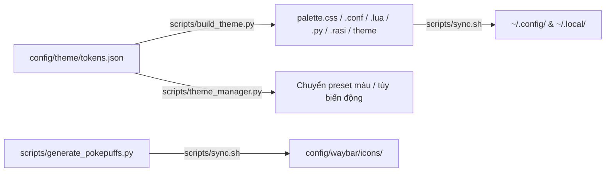

# Bản đồ toàn bộ file trong dự án (`Serena Dotfiles`)

Tài liệu này tổng hợp chức năng của từng file trong repo để bạn tra cứu nhanh khi cần chỉnh sửa, debug hoặc mở rộng.

---

## Tra cứu nhanh: Muốn sửa gì → Mở file nào?

| Bạn muốn làm gì? | File chính cần mở | Ghi chú |
| :--- | :--- | :--- |
| Đổi **màu sắc, font chữ, bo góc** toàn hệ thống | [`config/theme/tokens.json`](config/theme/tokens.json) | Sau đó chạy `./sync.sh` hoặc `python3 scripts/build_theme.py` (không sửa tay các file `palette.*`) |
| Đẩy config từ repo ra `~/.config/` & reload live | [`scripts/sync.sh`](scripts/sync.sh) (hoặc [`sync.sh`](sync.sh)) | Hỗ trợ `--pull` (kéo từ `~/.config` về) và `--diff` (so lệch) |
| Đổi **phím tắt, window rule, autostart, animation** Hyprland | [`config/hypr/hyprland.lua`](config/hypr/hyprland.lua) | Cấu hình Lua Engine cho Hyprland v0.56+ |
| Sửa **thanh trạng thái Waybar** | [`config/waybar/config.jsonc`](config/waybar/config.jsonc), [`config/waybar/style.css`](config/waybar/style.css) | Icon Poképuff lấy từ `scripts/generate_pokepuffs.py` |
| Sửa **màn hình khóa** | [`config/hypr/hyprlock.conf`](config/hypr/hyprlock.conf) | Tự import `palette.conf` |
| Sửa **Control Center & Thông báo** (`Super + N`) | [`config/hypr/scripts/popups/control_center.py`](config/hypr/scripts/popups/control_center.py) + `control_center_pkg/` | CSS phụ trợ ở `config/hypr/styles/control_center.css` |
| Sửa **Shelf — Clipboard & Ghim file** (`Super + V` / `D`) | [`config/hypr/scripts/popups/shelf.py`](config/hypr/scripts/popups/shelf.py) + `shelf_pkg/` | CSS phụ trợ ở `config/hypr/styles/shelf.css` |
| Sửa **Settings nắp gập** (`Super + P`) | [`config/hypr/scripts/popups/settings.py`](config/hypr/scripts/popups/settings.py) + `settings_pkg/` | Dùng thư viện `ui_core` + `settings_pkg/` |
| Sửa **Widget nền Desktop** (Profile, Thời tiết, Lịch) | [`config/hypr/scripts/widgets/desktop_widgets.py`](config/hypr/scripts/widgets/desktop_widgets.py) + `panels/` | Tọa độ thời tiết mặc định trong `config/hypr/weather_location.json` |
| Sửa **Trình phát nhạc & Lyric/Spectrum Kitty** (`Super + M`) | [`config/hypr/scripts/terminal/music.py`](config/hypr/scripts/terminal/music.py) | Kết hợp cùng các module `music_*.py` |
| Sửa **Thống kê thời gian dùng app/web** (`apptime`) | [`config/hypr/scripts/services/app_tracker.py`](config/hypr/scripts/services/app_tracker.py) + `tracker/` | Lưu SQLite ở `~/.local/share/app_tracker/usage.db` |
| Chạy **unit test** kiểm tra hồi quy | `python3 -m unittest discover -s tests` | Các file kiểm thử nằm trong `tests/` |

---

## Luồng sinh theme & đồng bộ

---

## 1. Thư mục gốc, Cài đặt & Công cụ quản trị

### Thư mục gốc
| File | Chức năng |
| :--- | :--- |
| [`README.md`](README.md) | Tài liệu giới thiệu dự án, hướng dẫn cài đặt nhanh và bảng phím tắt. |
| [`AGENTS.md`](AGENTS.md) | Quy chuẩn UI/UX (bảng màu Serena Wine, quy tắc layout, CSS, ngôn ngữ). |
| [`FILE_MAP.md`](FILE_MAP.md) | File tổng hợp chức năng của từng file trong toàn bộ repo (file này). |
| [`sync.sh`](sync.sh) | Symlink ở root trỏ tới `scripts/sync.sh` để chạy nhanh `./sync.sh`. |
| [`pyrightconfig.json`](pyrightconfig.json) | Cấu hình `extraPaths` cho Pyright/VS Code hiểu đúng import nội bộ giữa `scripts/`, `popups/`, `widgets/`, `services/`, `terminal/`, `ui_core/`. |
| [`.gitignore`](.gitignore) | Loại trừ `__pycache__`, file `.pid`, backup, `archive/`, `.vscode/`, `.agents/`. |

### `scripts/` — Công cụ build theme & đồng bộ
| File | Chức năng |
| :--- | :--- |
| [`scripts/build_theme.py`](scripts/build_theme.py) | Đọc `config/theme/tokens.json` và biên dịch ra toàn bộ file palette/theme cho Waybar, Hyprland (`.conf` & `.lua`), Rofi, GTK 3/4, SwayNC, Wlogout, Python (`palette.py`), Btop, Cava, Kitty, Fastfetch, Firefox. |
| [`scripts/theme_manager.py`](scripts/theme_manager.py) | Quản lý preset theme và đồng bộ bảng màu hệ thống qua CLI. |
| [`scripts/generate_pokepuffs.py`](scripts/generate_pokepuffs.py) | Sinh cặp icon SVG/PNG Poképuff (active, hover, inactive) cho Waybar và thư mục `assets/icons/`. |
| [`scripts/sync.sh`](scripts/sync.sh) | Script đồng bộ chính giữa `config/` ↔ `~/.config/`, copy avatar/wallpaper/icon/cursor, build theme, hot-reload Hyprland/Waybar/Fcitx5/Kitty/SwayNC/Desktop widgets; hỗ trợ `--pull` và `--diff`. |
| [`scripts/enable_autologin.sh`](scripts/enable_autologin.sh) | Cấu hình TTY1 autologin phục vụ vào thẳng Hyprland + Hyprlock mượt khi khởi động. |

### `install/` & `plymouth/spotlight/`
| File | Chức năng |
| :--- | :--- |
| [`install/setup_endeavouros.sh`](install/setup_endeavouros.sh) | Bộ cài tự động 1 chạm cho EndeavourOS / Arch Linux (Pacman + Yay, cursor, Plymouth, chạy `sync.sh`). |
| [`install/setup_ubuntu.sh`](install/setup_ubuntu.sh) | Bộ cài đặt Hyprland & dependencies tương ứng cho Ubuntu 24.04. |
| [`plymouth/spotlight/spotlight.plymouth`](plymouth/spotlight/spotlight.plymouth) | File khai báo theme khởi động Plymouth tên `Spotlight`. |
| [`plymouth/spotlight/spotlight.script`](plymouth/spotlight/spotlight.script) | Script Plymouth chạy chuỗi frame ánh đèn sân khấu khi boot/shutdown. |
| [`plymouth/spotlight/generate_theme.py`](plymouth/spotlight/generate_theme.py) | Sinh 45 ảnh frame (`frames/frame-0.png` … `frame-44.png`) và `background.png` cho Plymouth. |
| [`plymouth/spotlight/install.sh`](plymouth/spotlight/install.sh) | Cài đặt và kích hoạt Plymouth theme `spotlight` trên hệ thống (`mkinitcpio` / `plymouth-set-default-theme`). |

---

## 2. Cấu hình ứng dụng & Giao diện (`config/`)

> **Lưu ý:** Các file `palette.*`, `colors-rofi.rasi`, `obsidian-wine.theme`, `kitty.conf`, `cava/config` (phần màu), `fastfetch/config.jsonc` (phần màu) được sinh/cập nhật tự động từ [`config/theme/tokens.json`](config/theme/tokens.json) bởi `build_theme.py`.

### Design Tokens & Hyprland Core
| File | Chức năng |
| :--- | :--- |
| [`config/theme/tokens.json`](config/theme/tokens.json) | **Nguồn chân lý duy nhất (Single Source of Truth)** cho màu sắc, typography, spacing và border radius. |
| [`config/hypr/hyprland.lua`](config/hypr/hyprland.lua) | File cấu hình chính của Hyprland (Lua engine): monitor, input, autostart, window rules, animations, keybindings. |
| [`config/hypr/hyprlock.conf`](config/hypr/hyprlock.conf) | Giao diện màn hình khóa Hyprlock (đồng hồ, avatar Serena, ô nhập mật khẩu). |
| [`config/hypr/palette.conf`](config/hypr/palette.conf) | Biến màu, font, bo góc dạng Hyprlang (tự sinh từ `tokens.json`). |
| [`config/hypr/palette.lua`](config/hypr/palette.lua) | Bảng token Lua để `hyprland.lua` `require`/nạp trực tiếp (tự sinh từ `tokens.json`). |
| [`config/hypr/weather_location.json`](config/hypr/weather_location.json) | Cấu hình tọa độ/thành phố mặc định (`Hanoi`) và chế độ tự dò vị trí cho widget thời tiết. |
| [`config/hypr/serena_lock_avatar.png`](config/hypr/serena_lock_avatar.png) | Ảnh avatar dùng trên màn hình khóa Hyprlock. |
| [`config/hypr/styles/palette.css`](config/hypr/styles/palette.css) | Định nghĩa `@define-color` dùng chung cho GTK CSS của các popup/widget (tự sinh). |
| [`config/hypr/styles/control_center.css`](config/hypr/styles/control_center.css) | CSS riêng cho `control_center.py`. |
| [`config/hypr/styles/desktop_widgets.css`](config/hypr/styles/desktop_widgets.css) | CSS riêng cho các widget nền desktop (`desktop_widgets.py`). |
| [`config/hypr/styles/shelf.css`](config/hypr/styles/shelf.css) | CSS riêng cho cửa sổ Shelf & Clipboard (`shelf.py`). |

### Thanh trạng thái, Launcher, Terminal & Hệ thống app
| Nhóm / File | Chức năng |
| :--- | :--- |
| [`config/waybar/config.jsonc`](config/waybar/config.jsonc) | Layout & module của Waybar (workspace, IME, media, recording status, pin, đồng hồ, nút mở popup). |
| [`config/waybar/style.css`](config/waybar/style.css) | Style Tactile 3D cho Waybar, import từ [`config/waybar/palette.css`](config/waybar/palette.css). |
| [`config/waybar/icons/`](config/waybar/icons/) | Bộ icon Poképuff (`.svg` + `.png`) cho module workspaces trên Waybar. |
| [`config/rofi/config.rasi`](config/rofi/config.rasi) | Giao diện trình chạy ứng dụng Rofi phong cách Tactile 3D. |
| [`config/rofi/colors-rofi.rasi`](config/rofi/colors-rofi.rasi) | Biến màu, font, radius cho Rofi (tự sinh). |
| [`config/kitty/kitty.conf`](config/kitty/kitty.conf) | Cấu hình Kitty Terminal (font, opacity, remote control, colorscheme tự sinh). |
| [`config/kitty/music_control.py`](config/kitty/music_control.py) | Watcher/script điều khiển nền và padding riêng cho cửa sổ Kitty khi chạy trình nhạc. |
| [`config/starship/starship.toml`](config/starship/starship.toml) | Prompt shell dạng capsule/bubble cho Zsh/Bash qua Starship. |
| [`config/fastfetch/config.jsonc`](config/fastfetch/config.jsonc) | Cấu hình hiển thị thông số hệ thống của Fastfetch (kèm CPU rút gọn và màu tự sinh). |
| [`config/fastfetch/sylveon_chibi.txt`](config/fastfetch/sylveon_chibi.txt) | ASCII/ANSI art Sylveon hiển thị bên trái Fastfetch. |
| [`config/btop/btop.conf`](config/btop/btop.conf) | Cấu hình monitor tài nguyên `btop`. |
| [`config/btop/themes/obsidian-wine.theme`](config/btop/themes/obsidian-wine.theme) | Theme màu Serena Wine cho `btop` (tự sinh). |
| [`config/cava/config`](config/cava/config) | Cấu hình sóng âm terminal `cava` và gradient màu (phần màu tự sinh). |
| [`config/swaync/config.json`](config/swaync/config.json) | Cấu hình daemon thông báo SwayNC. |
| [`config/swaync/style.css`](config/swaync/style.css) | CSS bảng thông báo SwayNC, import [`config/swaync/palette.css`](config/swaync/palette.css). |
| [`config/wlogout/layout`](config/wlogout/layout) | Khai báo 5 nút nguồn (Lock, Logout, Suspend, Reboot, Shutdown) cho Wlogout. |
| [`config/wlogout/style.css`](config/wlogout/style.css) | CSS menu Wlogout, dùng icon ở `config/wlogout/icons/` và [`config/wlogout/palette.css`](config/wlogout/palette.css). |
| [`config/swappy/config`](config/swappy/config) | Thư mục lưu mặc định (`Pictures/Screenshots`) và thiết lập cho công cụ chú thích ảnh `swappy`. |
| [`config/applications/serena-player.desktop`](config/applications/serena-player.desktop) | Desktop entry đăng ký `Serena Music` vào launcher hệ thống. |
| [`config/Thunar/uca.xml`](config/Thunar/uca.xml) | Custom Actions chuột phải trong trình quản lý file Thunar. |

### GTK, Firefox & Bộ gõ tiếng Việt (Fcitx5)
| Nhóm / File | Chức năng |
| :--- | :--- |
| [`config/gtk-3.0/gtk.css`](config/gtk-3.0/gtk.css), [`settings.ini`](config/gtk-3.0/settings.ini), [`bookmarks`](config/gtk-3.0/bookmarks), [`palette.css`](config/gtk-3.0/palette.css) | Giao diện, font, dấu trang và biến màu cho ứng dụng GTK 3. |
| [`config/gtk-4.0/gtk.css`](config/gtk-4.0/gtk.css), [`settings.ini`](config/gtk-4.0/settings.ini), [`palette.css`](config/gtk-4.0/palette.css) | Giao diện Libadwaita / GTK 4 và biến màu đồng bộ. |
| [`config/firefox/user.js`](config/firefox/user.js) | Bật `toolkit.legacyUserProfileCustomizations.stylesheets` và tinh chỉnh UX Firefox. |
| [`config/firefox/chrome/userChrome.css`](config/firefox/chrome/userChrome.css) | CSS thanh tab/UI Firefox kiểu Floating Island Serena Wine. |
| [`config/firefox/chrome/userContent.css`](config/firefox/chrome/userContent.css) | CSS trang New Tab / nội bộ (`about:*`) của Firefox. |
| [`config/firefox/chrome/palette.css`](config/firefox/chrome/palette.css) | Biến màu CSS cho Firefox (tự sinh). |
| [`config/fcitx5/config`](config/fcitx5/config), [`profile`](config/fcitx5/profile) | Cấu hình chung Fcitx5 và danh sách profile bộ gõ. |
| [`config/fcitx5/conf/ngosen.conf`](config/fcitx5/conf/ngosen.conf), [`ngosen-app-switch.conf`](config/fcitx5/conf/ngosen-app-switch.conf), [`notifications.conf`](config/fcitx5/conf/notifications.conf) | Cấu hình bộ gõ Ngó Sen (gợi ý theo app, ẩn thông báo chẩn đoán Wayland thừa). |

---

## 3. Hệ thống Python UI, Services & Scripts (`config/hypr/scripts/`)

### 3.1. `ui_core/` — Thư viện nền tảng dùng chung
| File | Chức năng |
| :--- | :--- |
| [`ui_core/__init__.py`](config/hypr/scripts/ui_core/__init__.py) | Export công khai tất cả primitive của `ui_core`. |
| [`ui_core/assets.py`](config/hypr/scripts/ui_core/assets.py) | Tìm đường dẫn gốc repo và resolve file ảnh/asset dù chạy từ repo hay `~/.config/`. |
| [`ui_core/base_window.py`](config/hypr/scripts/ui_core/base_window.py) | Lớp `DraggablePopup`: cửa sổ GtkLayerShell kéo-thả mượt và tự nhớ tọa độ vị trí. |
| [`ui_core/shapes.py`](config/hypr/scripts/ui_core/shapes.py) | Các hàm vẽ Cairo cơ bản (`clear_surface`, `draw_rounded_rect`, `squircle`, `draw_bow_mark`, `draw_bell_icon`, `clip_device_bounds`). |
| [`ui_core/tactile.py`](config/hypr/scripts/ui_core/tactile.py) | Hiệu ứng Tactile 3D cel-shaded cho nút bấm/card phong cách anime. |
| [`ui_core/typography.py`](config/hypr/scripts/ui_core/typography.py) | Helper dựng Pango font, vẽ chữ uốn cong (`draw_curved_kerned` có cache) và chữ 3D (`draw_tactile_3d_text`). |

### 3.2. `popups/` — Các cửa sổ bật lên (Control Center, Shelf, Settings)
| File | Chức năng |
| :--- | :--- |
| [`popups/draggable_popup.py`](config/hypr/scripts/popups/draggable_popup.py) | File shim giữ tương thích ngược, chuyển tiếp import sang `ui_core.base_window`. |
| [`popups/toggle_control_center.sh`](config/hypr/scripts/popups/toggle_control_center.sh) | Script shell bật/tắt (hoặc chuyển trang) Control Center cho phím tắt / Waybar. |
| [`popups/toggle_shelf.sh`](config/hypr/scripts/popups/toggle_shelf.sh) | Script shell bật/tắt Shelf (hỗ trợ mở thẳng tab Clipboard hoặc Files). |
| [`popups/toggle_settings.sh`](config/hypr/scripts/popups/toggle_settings.sh) | Script shell bật/tắt cửa sổ Settings nắp gập. |
| [`popups/toggle_music.sh`](config/hypr/scripts/popups/toggle_music.sh) | Script chuyển tiếp sang `terminal/toggle_music.sh`. |
| **Control Center (`control_center.py` + `control_center_pkg/`)** | |
| [`popups/control_center.py`](config/hypr/scripts/popups/control_center.py) | Entrypoint ghép các mixin thành `PokedexControlCenter`, quản lý PID/tín hiệu `SIGUSR1` và vòng lặp GTK. |
| [`control_center_pkg/__init__.py`](config/hypr/scripts/popups/control_center_pkg/__init__.py) | Đánh dấu package `control_center_pkg`. |
| [`control_center_pkg/constants.py`](config/hypr/scripts/popups/control_center_pkg/constants.py) | Thiết lập `gi.require_version`, đường dẫn cache/PID, token màu `C_*` và helper `hex_to_rgba`. |
| [`control_center_pkg/shapes.py`](config/hypr/scripts/popups/control_center_pkg/shapes.py) | Vẽ vỏ Pokédex trên/dưới, dual slider Âm lượng/Độ sáng ở giữa, format thời gian tương đối & badge app thông báo. |
| [`control_center_pkg/services_mixin.py`](config/hypr/scripts/popups/control_center_pkg/services_mixin.py) | Poll nền Wi-Fi, Bluetooth, âm lượng, độ sáng, pin/nguồn, IME và đọc danh sách thông báo từ `notif_daemon`. |
| [`control_center_pkg/render_mixin.py`](config/hypr/scripts/popups/control_center_pkg/render_mixin.py) | Pipeline bake surface tĩnh và render giao diện Control Center lên Cairo canvas. |
| [`control_center_pkg/interaction_mixin.py`](config/hypr/scripts/popups/control_center_pkg/interaction_mixin.py) | Xử lý click, kéo slider vòng cung, cuộn chuột, phím tắt và chuyển tab trong Control Center. |
| **Shelf (`shelf.py` + `shelf_pkg/`)** | |
| [`popups/shelf.py`](config/hypr/scripts/popups/shelf.py) | Entrypoint ghép các mixin thành `ShelfWindow`, hỗ trợ chế độ `--daemon` chạy ngầm, PID/signal và chuyển tab. |
| [`shelf_pkg/__init__.py`](config/hypr/scripts/popups/shelf_pkg/__init__.py) | Đánh dấu package `shelf_pkg`. |
| [`shelf_pkg/constants.py`](config/hypr/scripts/popups/shelf_pkg/constants.py) | Đường dẫn `SHELF_DIR`, `CLIPHIST_DB`, `PINNED_FILE`, bảng DnD targets và token màu. |
| [`shelf_pkg/storage.py`](config/hypr/scripts/popups/shelf_pkg/storage.py) | Giải mã thumbnail ảnh từ `cliphist` bất đồng bộ, lưu/tải clip đã ghim, khởi động `wl-paste` watcher, format dung lượng file. |
| [`shelf_pkg/clipboard_tab.py`](config/hypr/scripts/popups/shelf_pkg/clipboard_tab.py) | UI tab Lịch sử Clipboard: đọc `cliphist list`, lọc tìm kiếm, copy lại, ghim/xóa từng mục. |
| [`shelf_pkg/file_tab.py`](config/hypr/scripts/popups/shelf_pkg/file_tab.py) | UI tab Kệ Ghim File: kéo-thả file vào/ra (`Drag & Drop`), metadata file, sao chép nhanh hoặc cất file từ clipboard. |
| [`shelf_pkg/popout.py`](config/hypr/scripts/popups/shelf_pkg/popout.py) | Cửa sổ popout xem trước nội dung/ảnh khi rê chuột và chế độ lightbox phóng to toàn màn hình. |
| **Settings (`settings.py` + `settings_pkg/`)** | |
| [`popups/settings.py`](config/hypr/scripts/popups/settings.py) | Entrypoint ghép các mixin thành `SettingsWindow`, quản lý hoạt ảnh mở/đóng, PID/signal. |
| [`settings_pkg/__init__.py`](config/hypr/scripts/popups/settings_pkg/__init__.py) | Đánh dấu package `settings_pkg`. |
| [`settings_pkg/constants.py`](config/hypr/scripts/popups/settings_pkg/constants.py) | Kích thước đóng/mở nắp (`CLOSED_*`, `OPEN_*`), hằng số animation, `PID_FILE` và token màu RGBA. |
| [`settings_pkg/shapes.py`](config/hypr/scripts/popups/settings_pkg/shapes.py) | Vẽ hình dáng hai cánh vỏ gập (`left_panel_path`, `right_panel_path`, `front_cover_path`) và nơ ruy băng Cairo. |
| [`settings_pkg/services_mixin.py`](config/hypr/scripts/popups/settings_pkg/services_mixin.py) | Nạp asset ảnh bản đồ/nơ và poll thông số CPU, RAM, nhiệt độ, pin, kết nối cho 2 màn hình Settings. |
| [`settings_pkg/render_mixin.py`](config/hypr/scripts/popups/settings_pkg/render_mixin.py) | Render từng khung hình gập-mở vỏ và nội dung trạng thái thiết bị / điều khiển nhanh. |
| [`settings_pkg/interaction_mixin.py`](config/hypr/scripts/popups/settings_pkg/interaction_mixin.py) | Xử lý click, cuộn, phím tắt và chuyển đổi các mục cấu hình trên cửa sổ Settings. |

### 3.3. `widgets/` — Widget ghim trên nền Desktop
| File | Chức năng |
| :--- | :--- |
| [`widgets/desktop_widgets.py`](config/hypr/scripts/widgets/desktop_widgets.py) | Entrypoint khởi chạy 3 cửa sổ widget ghim dưới nền desktop (`ProfileCardWindow`, `WeatherForecastWindow`, `DesktopCalendarWindow`) + quản lý GC/signal. |
| [`widgets/toggle_desktop_widgets.sh`](config/hypr/scripts/widgets/toggle_desktop_widgets.sh) | Script bật/tắt hoặc khởi động lại cụm widget desktop. |
| [`widgets/panels/__init__.py`](config/hypr/scripts/widgets/panels/__init__.py) | Đánh dấu package `panels`. |
| [`widgets/panels/common.py`](config/hypr/scripts/widgets/panels/common.py) | Thiết lập GTK 3 / LayerShell, nạp `palette.py`, áp CSS `desktop_widgets.css`, tính uptime. |
| [`widgets/panels/profile_card.py`](config/hypr/scripts/widgets/panels/profile_card.py) | Widget góc trên trái hiển thị avatar Serena, tên máy/user và uptime. |
| [`widgets/panels/weather_service.py`](config/hypr/scripts/widgets/panels/weather_service.py) | Định vị tọa độ (config/cache/IP có kiểm tra VPN), tra mã thời tiết WMO và parse dữ liệu Open-Meteo / wttr.in. |
| [`widgets/panels/weather_widget.py`](config/hypr/scripts/widgets/panels/weather_widget.py) | Widget góc trên phải hiển thị nhiệt độ 3D tactile và dự báo thời tiết nhiều ngày. |
| [`widgets/panels/calendar_widget.py`](config/hypr/scripts/widgets/panels/calendar_widget.py) | Widget lịch 3D tương tác nằm dưới thẻ thời tiết (chuyển tháng, đánh dấu ngày hiện tại). |

### 3.4. `services/` — Dịch vụ nền, phần cứng & App Tracker
| File | Chức năng |
| :--- | :--- |
| [`services/__init__.py`](config/hypr/scripts/services/__init__.py) | Khởi tạo package `services`, export `AudioService`. |
| [`services/audio.py`](config/hypr/scripts/services/audio.py) | Điều khiển âm lượng, mute loa/mic thông qua `pamixer` / `wpctl`. |
| [`services/brightness.py`](config/hypr/scripts/services/brightness.py) | Đọc và chỉnh độ sáng màn hình qua `brightnessctl` / `/sys/class/backlight`. |
| [`services/wifi.py`](config/hypr/scripts/services/wifi.py) | Quản lý Wi-Fi (`WifiService`): quét mạng, kết nối, bật/tắt radio qua `nmcli`. |
| [`services/bluetooth.py`](config/hypr/scripts/services/bluetooth.py) | Quản lý Bluetooth qua `rfkill` và `bluetoothctl`. |
| [`services/power.py`](config/hypr/scripts/services/power.py) | Đọc trạng thái pin, AC adapter và cấu hình power profile. |
| [`services/power_monitor.py`](config/hypr/scripts/services/power_monitor.py) | Theo dõi pin, tải CPU và ước tính công suất tiêu thụ theo thời gian thực. |
| [`services/battery_alert.py`](config/hypr/scripts/services/battery_alert.py) | Daemon chạy ngầm bắn thông báo cảnh báo khi pin xuống mức thấp. |
| [`services/notif_daemon.py`](config/hypr/scripts/services/notif_daemon.py) | Daemon lắng nghe D-Bus thông báo và ghi lịch sử để Control Center hiển thị. |
| [`services/hyprland_ipc_bridge.py`](config/hypr/scripts/services/hyprland_ipc_bridge.py) | Cầu nối IPC dịch các lệnh/dispatch legacy sang Hyprland Lua. |
| **App Tracker (`app_tracker.py` + `tracker/`)** | |
| [`services/app_tracker.py`](config/hypr/scripts/services/app_tracker.py) | CLI entrypoint (`apptime start/stop/status/session/today/details/web`) và re-export lớp/hàm từ `tracker/`. |
| [`tracker/__init__.py`](config/hypr/scripts/services/tracker/__init__.py) | Đánh dấu package `tracker`. |
| [`tracker/utils.py`](config/hypr/scripts/services/tracker/utils.py) | Đường dẫn SQLite/PID/log, hằng timeout/flush, bảng màu ANSI, rút gọn tên app/tiêu đề/tên miền, hyperlink OSC 8. |
| [`tracker/browser.py`](config/hypr/scripts/services/tracker/browser.py) | `FirefoxTabResolver`: giải mã file `recovery.jsonlz4` (`mozLz40`) của Firefox và đoán URL từ tiêu đề tab. |
| [`tracker/db.py`](config/hypr/scripts/services/tracker/db.py) | `TrackerDB`: quản lý SQLite WAL (`app_usage`, `app_titles`, `boot_meta`), ghi tích lũy thời gian và truy vấn thống kê. |
| [`tracker/daemon.py`](config/hypr/scripts/services/tracker/daemon.py) | `HyprlandAppTracker`: bám socket2 Hyprland theo dõi cửa sổ active + thời gian nhàn rỗi, điều khiển daemon start/stop/status. |
| [`tracker/cli_report.py`](config/hypr/scripts/services/tracker/cli_report.py) | Dựng biểu đồ phân bổ thanh ngang và bảng báo cáo terminal (`session`, `today`, `details`, `web`). |

### 3.5. `system/` — Script tiện ích hệ thống
| File | Chức năng |
| :--- | :--- |
| [`system/palette.py`](config/hypr/scripts/system/palette.py) | Các biến màu/font/radius Python cho toàn bộ widget & popup (tự sinh từ `tokens.json`). |
| [`system/Battery.sh`](config/hypr/scripts/system/Battery.sh) | Trả về trạng thái & phần trăm pin dùng cho thanh bar/lockscreen. |
| [`system/LockScreen.sh`](config/hypr/scripts/system/LockScreen.sh) | Gọi `hyprlock` an toàn (tránh mở chồng nếu đã chạy). |
| [`system/boot_lock.sh`](config/hypr/scripts/system/boot_lock.sh) | Khóa màn hình mượt lúc khởi động, chuyển giao từ Plymouth vào Hyprlock. |
| [`system/OpenApps.sh`](config/hypr/scripts/system/OpenApps.sh) | Bật/tắt menu Rofi. |
| [`system/Wlogout.sh`](config/hypr/scripts/system/Wlogout.sh) | Bật/tắt menu nguồn Wlogout. |
| [`system/get_ime.sh`](config/hypr/scripts/system/get_ime.sh) | In trạng thái bộ gõ hiện tại (VIE / ENG) cho Waybar. |
| [`system/init_ime.sh`](config/hypr/scripts/system/init_ime.sh) | Khởi động/nạp lại daemon Fcitx5 khi vào Hyprland. |
| [`system/toggle_vietnamese.sh`](config/hypr/scripts/system/toggle_vietnamese.sh) | Chuyển nhanh tiếng Việt / tiếng Anh qua `fcitx5-remote`. |
| [`system/get_media.py`](config/hypr/scripts/system/get_media.py) | Đọc trạng thái nhạc MPRIS xuất JSON cho module Waybar. |
| [`system/screenshot.sh`](config/hypr/scripts/system/screenshot.sh) | Chụp ảnh màn hình bằng `grim` + `slurp` (+ mở `swappy` / lưu ảnh). |
| [`system/record_screen.sh`](config/hypr/scripts/system/record_screen.sh) | Quay màn hình toàn màn hoặc vùng chọn kèm âm thanh hệ thống (`wf-recorder`). |
| [`system/recording_status.sh`](config/hypr/scripts/system/recording_status.sh) | Xuất JSON trạng thái đang quay màn hình cho Waybar. |
| [`system/wallpaper_switcher.py`](config/hypr/scripts/system/wallpaper_switcher.py) | Chuyển hình nền tiếp theo bằng `swww`/`hyprpaper` và đồng bộ hiệu ứng. |

### 3.6. `terminal/` — Trình phát nhạc & Visualizer trong Kitty
| File | Chức năng |
| :--- | :--- |
| [`terminal/music.py`](config/hypr/scripts/terminal/music.py) | Entrypoint chính của trình trực quan nhạc terminal (spectrum + lyrics đồng bộ). |
| [`terminal/music_layout.py`](config/hypr/scripts/terminal/music_layout.py) | Chia vùng hiển thị (header, lyrics, sóng spectrum) theo kích thước cửa sổ terminal. |
| [`terminal/music_spectrum.py`](config/hypr/scripts/terminal/music_spectrum.py) | Render phổ sóng âm pixel (Kitty graphics / block) theo gradient màu trong `tokens.json`. |
| [`terminal/music_lyrics.py`](config/hypr/scripts/terminal/music_lyrics.py) | Tìm và render lyric đồng bộ thời gian thực với viền chữ rõ nét trên nền trong suốt. |
| [`terminal/music_spotlight.py`](config/hypr/scripts/terminal/music_spotlight.py) | Hiệu ứng chùm sáng sân khấu mềm lấy cảm hứng từ Plymouth Spotlight. |
| [`terminal/music_focus.py`](config/hypr/scripts/terminal/music_focus.py) | Chế độ focus: làm tối desktop phía sau và chỉ giữ lớp lyric/spectrum nổi bật. |
| [`terminal/music_idle.py`](config/hypr/scripts/terminal/music_idle.py) | Xử lý độ trong suốt khi nhàn rỗi và phím điều khiển tương tác trong terminal. |
| [`terminal/music_player.py`](config/hypr/scripts/terminal/music_player.py) | CLI quản lý thư viện nhạc local và điều khiển phát nhạc trong terminal. |
| [`terminal/music_player_engine.py`](config/hypr/scripts/terminal/music_player_engine.py) | Engine phát nhạc local dùng `mpv`, lưu playlist và trạng thái phát. |
| [`terminal/music_player_mpris.py`](config/hypr/scripts/terminal/music_player_mpris.py) | Kết nối MPRIS D-Bus cho trình phát nhạc local. |
| [`terminal/toggle_music.sh`](config/hypr/scripts/terminal/toggle_music.sh) | Bật/tắt cửa sổ Kitty chạy `music.py` (hoặc chạy trực tiếp nếu đang ở sẵn trong terminal). |
| [`terminal/open_music_player.sh`](config/hypr/scripts/terminal/open_music_player.sh) | Mở cửa sổ thư viện trình phát nhạc terminal `music_player.py`. |

---

## 4. Kiểm thử (`tests/`), Công cụ phát triển (`dev_tools/`) & Tài nguyên (`assets/`)

### `tests/` — Unit Tests
| File | Kiểm tra module nào? |
| :--- | :--- |
| [`tests/test_ui_core.py`](tests/test_ui_core.py) | Test `ui_core` (tìm repo root, resolve asset, Cairo surface/shapes/text cache). |
| [`tests/test_wifi_service.py`](tests/test_wifi_service.py) | Test `services/wifi.py` (parse đầu ra `nmcli` và quản lý trạng thái kết nối). |
| [`tests/test_tracker.py`](tests/test_tracker.py) | Test gói `tracker/` (`utils`, giải mã `mozlz4` trong `browser`, SQLite `TrackerDB`, `aggregate_apps`, `draw_stacked_distribution`). |
| [`tests/test_widgets_and_popups.py`](tests/test_widgets_and_popups.py) | Test các module vừa tách: `weather_service`, `control_center_pkg.shapes`, `shelf_pkg.storage`, `settings_pkg.shapes`. |
| [`tests/test_music.py`](tests/test_music.py) | Test hồi quy cho `music.py` và bộ renderer spectrum/lyrics. |
| [`tests/test_music_focus.py`](tests/test_music_focus.py) | Test lifecycle & IPC của `music_focus.py`. |
| [`tests/test_music_idle.py`](tests/test_music_idle.py) | Test chế độ idle và xử lý input của `music_idle.py`. |
| [`tests/test_music_player.py`](tests/test_music_player.py) | Test engine `music_player*` (phát local, lưu playlist, MPRIS metadata). |

### `dev_tools/` — Công cụ tạo tài nguyên thủ công (chỉ dùng khi dev)
| File | Chức năng |
| :--- | :--- |
| [`dev_tools/cursor_builder/build_linux_cursors.py`](dev_tools/cursor_builder/build_linux_cursors.py) | Biên dịch các sprite con trỏ thành gói Xcursor & Hyprcursor hoàn chỉnh. |
| [`dev_tools/cursor_builder/generate_sylveon_custom.py`](dev_tools/cursor_builder/generate_sylveon_custom.py) | Tạo file `.cur` / frame biến thể cho bộ con trỏ `sylveon-custom`. |
| [`dev_tools/cursor_builder/generate_sylveon_sheet.py`](dev_tools/cursor_builder/generate_sylveon_sheet.py) | Tô lại màu & xuất sheet sprite ruy băng Sylveon chuẩn tông anime wine-red / pastel. |
| [`dev_tools/wallpaper_generator/generate_ascii_wallpaper.py`](dev_tools/wallpaper_generator/generate_ascii_wallpaper.py) | Chuyển ảnh `serena_fennekin_wallpaper_hd.jpg` thành hình nền ASCII art 1920×1080. |
| [`dev_tools/wallpaper_generator/make_sunset_no_city.py`](dev_tools/wallpaper_generator/make_sunset_no_city.py) | Vẽ cánh đồng hoa hoàng hôn sạch (loại bỏ nền thành phố phía xa) bằng Pillow. |
| [`dev_tools/wallpaper_generator/restore_original_characters.pl`](dev_tools/wallpaper_generator/restore_original_characters.pl) | Script Perl ghép lại pixel nhân vật gốc dùng mask hướng dẫn. |
| `dev_tools/wallpaper_generator/layers/` & `dev_tools/cursor_builder/raw_sources/` | Ảnh nguồn thô, mask trung gian, prompt phục dựng và readme ghi chú quá trình tạo asset. |

### `assets/` & `config/hypr/assets/` — Kho ảnh & Icon sản phẩm
| Thư mục | Nội dung |
| :--- | :--- |
| `assets/wallpapers/` | Hình nền HD đã hoàn thiện (được `sync.sh` chép sang `~/Pictures/wallpapers/`). |
| `assets/avatars/` | Avatar Serena (profile/lockscreen) và Sylveon chibi. |
| `assets/banners/` | Ảnh banner bìa dùng cho UI popup. |
| `assets/icons/` | Bộ icon SVG & PNG tùy biến (Pokéball, nơ Serena, ruy băng, Poképuff, braixen wand, pancham sunglasses...). |
| `assets/illustrations/` | Tranh minh họa nhóm Serena dùng trang trí dashboard/popup. |
| `assets/pokemon/` | Sprite Pokémon (Sylveon, Braixen, Pancham). |
| `assets/cursors/sylveon-custom/` | Bộ theme con trỏ Sylveon Custom (được `sync.sh` chép sang `~/.icons` & `~/.local/share/icons`). |
| `config/hypr/assets/` | Các ảnh cắt gọn dành riêng cho popup Hyprland (bản đồ Kalos, guide Dendemille, nút tim, bản lề, nơ sạch) được `ui_core/assets.py` nạp trực tiếp. |
